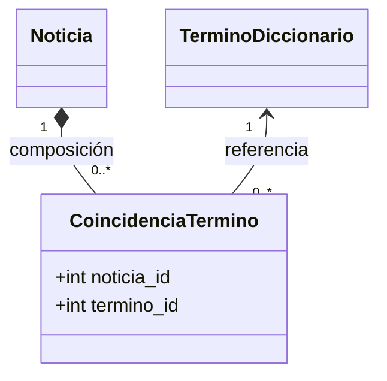

# HU-SENT-008 — Persistencia de coincidencias término–noticia (EPIC-SENT)

**Proyecto:** HumWorld — Equipo 3
**Origen:** PDF de especificaciones, sección 4.3.1 (Dashboard de palabras influyentes) y sección 10.2 (`/dashboards`: nube de palabras). Historia derivada de HU-DASH-003-v2, que necesita un dato que ninguna historia de EPIC-SENT persistía (hallazgo H-2 de `Revision-consistencia-EPIC-DASH-2026-10-05.md`).
**Estado:** Propuesto — decisión de diseño tomada en sesión del 2026-10-05 (tabla de unión, siempre, también en el camino de ML). Pendiente de ratificación del equipo y de estimación en Planning Poker.
**Ubicación:** este documento es un anexo de `HU-SENT-motor-sentimiento.md` (v1.5). Queda pendiente fusionarlo en ese documento como v1.6.

---

## HU-SENT-008 — Persistencia de coincidencias término–noticia

**Tipo:** Historia Técnica / Enabler Story *(el actor es el propio sistema)*
**Como** sistema HumWorld,
**quiero** registrar, para cada noticia capturada, qué términos del diccionario aparecen en su texto, con independencia del método que calcule su humor,
**para** que la nube de palabras influyentes (HU-DASH-003-v2) pueda obtenerse con una consulta agregada, sin volver a recorrer el texto de las noticias en cada lectura.

**Prioridad:** Alta *(bloquea HU-DASH-003-v2)*
**Estimación relativa:** M *(punto de partida propuesto por el agente PO/Arquitecto, no un valor definitivo: la historia no existía en el Planning Poker de P3 y el equipo debe estimarla en puntos antes de planificarla)*
**Sprint:** sin asignar. No forma parte de la planificación entregada en P3; el equipo debe decidir en qué sprint entra, sabiendo que HU-DASH-003-v2 no puede integrarse sin ella.
**Depende de contrato de API:** No expone endpoint propio. Sus datos se consultan a través de `GET /api/v1/dashboards/word-cloud` (`contrato-dashboards.openapi.yaml`).
**Variante del algoritmo:** no calcula humor. Reutiliza la detección de términos del método de diccionario (HU-SENT-007): coincidencia por término único, nunca por cantidad de apariciones.

### Relación con las historias existentes

- **HU-SENT-007** ya detecta los términos coincidentes para promediar sus valores, pero los descarta después del cálculo. Esta historia persiste ese mismo conjunto.
- **HU-SENT-002-v2** no cambia. Cuando el humor se calcula con el modelo de ML, el método de diccionario no se ejecuta para obtener `valor_humor`; esta historia exige ejecutar igualmente la detección de términos para registrar las coincidencias. `valor_humor` y `metodo_calculo` no se ven afectados.
- **Sin dependencia externa:** la detección opera sobre el texto ya persistido y el diccionario en MySQL, por lo que no introduce llamadas a servicios externos ni requiere patrones de resiliencia (mismo criterio que ADR-03, sección 4).

### Modelo de datos propuesto



- Tabla de unión propuesta: `noticia_termino`, con clave primaria compuesta (`noticia_id`, `termino_id`). La clave compuesta garantiza una sola fila por término y noticia.
- **Composición con `Noticia`:** una coincidencia no tiene sentido sin su noticia; al eliminarse la noticia (purgado, HU-ADMIN-002 y HU-ADMIN-003) sus coincidencias se eliminan con ella.
- Los nombres `CoincidenciaTermino` y `noticia_termino` son propuestas de este documento, a confirmar por el equipo antes de la migración. `diagrama-clases-sentimiento.md` (v1.1) afirma hoy que no existe relación persistida entre `Noticia` y `TerminoDiccionario`; debe actualizarse cuando esta historia se ratifique.

### Criterios de aceptación (Gherkin)

```gherkin
Escenario: Registro de coincidencias en una noticia calculada por diccionario
  Dado que el diccionario contiene "guerra" (es, -8) y "victoria" (es, +6)
  Y una noticia en español cuyo texto contiene exactamente esos dos términos evaluables
  Cuando el sistema procesa la noticia tras su captura
  Entonces quedan registradas exactamente 2 coincidencias para esa noticia, 1 por cada término

Escenario: Término repetido en el mismo texto
  Dado que el diccionario contiene "crisis" (es, -6)
  Y una noticia cuyo texto contiene la palabra "crisis" 3 veces y ningún otro término evaluable
  Cuando el sistema procesa la noticia
  Entonces queda registrada exactamente 1 coincidencia para esa noticia

Escenario: Noticia cuyo humor se calcula con el modelo de ML
  Dado que existe un modelo de ML activo y una noticia que contiene 2 términos del diccionario
  Cuando el sistema calcula su humor con metodo_calculo = "ml"
  Entonces quedan registradas igualmente las 2 coincidencias de esa noticia
  Y su valor_humor es el calculado por el modelo, sin modificación

Escenario: Noticia sin términos del diccionario
  Dado una noticia cuyo texto no contiene ningún término del diccionario
  Cuando el sistema procesa la noticia
  Entonces quedan registradas 0 coincidencias para esa noticia
  Y el procesamiento no produce ningún error

Escenario: Coincidencia limitada al idioma de la noticia
  Dado que el diccionario contiene un término en español y otro en inglés
  Y una noticia con idioma_detectado = "es" cuyo texto contiene ambas palabras
  Cuando el sistema procesa la noticia
  Entonces queda registrada únicamente la coincidencia del término en español

Escenario: Eliminación de una noticia
  Dado una noticia con 3 coincidencias registradas
  Cuando la noticia es eliminada por el purgado
  Entonces no queda ninguna coincidencia asociada a esa noticia
```

**Nota de grounding (idioma):** el criterio de comparar el idioma detectado de la noticia contra el idioma del término proviene de `ADR-03-eleccion-algoritmo-agregacion-sentimiento.md`, Decisión, punto 1.

### Puntos pendientes de decisión del equipo

1. **Noticias ya capturadas.** Las noticias anteriores a la puesta en marcha de esta historia no tienen coincidencias. Falta decidir si se recalculan una vez (proceso de carga retroactiva) o si la nube solo refleja noticias nuevas.
2. **Cambios posteriores en el diccionario.** Si se agrega un término después de capturada una noticia, esa noticia no lo registra. Falta decidir si se acepta esa limitación o si se reprocesa.
3. **Eliminación de un término con coincidencias** (`DELETE /api/v1/dictionary/{id}`, HU-SENT-001). Falta decidir entre eliminar sus coincidencias en cascada o rechazar la eliminación. Cualquiera de las dos afecta el contrato de HU-SENT-001.

### Definition of Done

(Bloque general DoD, sección 14 de las instrucciones del proyecto.) Adicionalmente:
- Migración de MySQL para la tabla de unión, documentada y revisada por el equipo antes de fusionar.
- Pruebas unitarias deterministas de los 6 escenarios Gherkin, con el modelo de ML simulado mediante mock en el escenario de `metodo_calculo = "ml"`.
- Prueba de unicidad: un segundo procesamiento de la misma noticia no duplica coincidencias.
- `diagrama-clases-sentimiento.md` actualizado con la nueva entidad.

---

## Tabla de control de versiones

| ID | Versión | Fecha/Sesión | Motivo del cambio |
|---|---|---|---|
| HU-SENT-008 | v1.0 | 2026-10-05 | Creación. Historia técnica nueva, originada en el hallazgo H-2 de la revisión de consistencia de EPIC-DASH: HU-DASH-003 dependía de coincidencias término–noticia que no se persistían. Decisión de sesión: tabla de unión, poblada siempre, también cuando el humor lo calcula el modelo de ML. |
