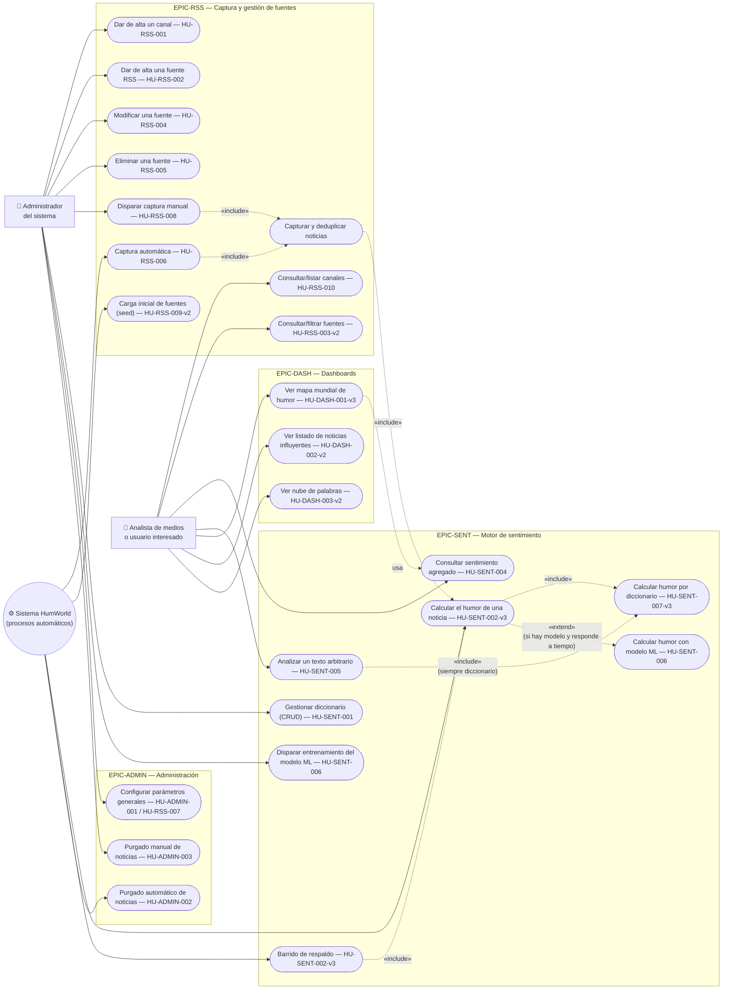

# Diagrama de Casos de Uso — HumWorld (sistema completo)

**Proyecto:** HumWorld — Equipo 3
**Origen:** PDF de especificaciones, sección 4.7.3.a ("Documentación UML de diseño → Diagrama de casos de uso").
**Alcance:** casos de uso de las cuatro épicas (EPIC-RSS, EPIC-SENT, EPIC-DASH, EPIC-ADMIN), con las historias vigentes del backlog.
**Estado:** refleja las funcionalidades implementadas en el sistema.

> **Nota de organización (2026-10-29):** este diagrama consolida en uno solo los casos de uso de todas las épicas. Antes estaban repartidos entre `diagrama-casos-de-uso.md` (EPIC-RSS) y `diagrama-casos-de-uso-sentimiento.md` (EPIC-SENT), y EPIC-DASH/EPIC-ADMIN no tenían diagrama. La separación por épica no estaba documentada como decisión del equipo; se unifica para cubrir el sistema completo en un único diagrama, como pide §4.7.3.a.

## Actores

| Actor | Rol |
|---|---|
| **Administrador del sistema** | Gestión de canales y fuentes (HU-RSS-001/002/004/005), captura manual (HU-RSS-008), configuración (HU-RSS-007, HU-ADMIN-001), gestión del diccionario (HU-SENT-001), disparo del entrenamiento (HU-SENT-006) y purgado manual (HU-ADMIN-003). |
| **Analista de medios o usuario interesado** | Consultas de solo lectura: listado de canales y fuentes (HU-RSS-003-v2, HU-RSS-010), sentimiento agregado (HU-SENT-004), análisis de texto (HU-SENT-005), y los dashboards (HU-DASH-001-v3, HU-DASH-002-v2, HU-DASH-003-v2). Grounded en PDF §4.1. |
| **Sistema HumWorld (procesos automáticos)** | Actor no humano: captura automática (HU-RSS-006), cálculo de humor tras cada captura y barrido de respaldo (HU-SENT-002-v3), purgado automático (HU-ADMIN-002) y carga inicial por script (HU-RSS-009-v2, diccionario). |

## Diagrama

## Notas de diseño

- **Captura reutilizada (`«include»`):** la captura manual (HU-RSS-008) y el cron automático (HU-RSS-006) comparten el mismo procedimiento de captura y deduplicación (`UCcapt`), implementado en `captura_service.py`.
- **Cálculo de humor disparado por la captura:** tras capturar una noticia, el sistema calcula su humor (HU-SENT-002-v3). Se modela como `UCcapt «include» UCS2`.
- **Diccionario siempre disponible, ML condicional:** `UCS2 «include» UCDicc` (el método de diccionario es el camino base y el fallback); `UCS2 «extend» UCML` (el camino de ML solo se ejecuta si existe un modelo entrenado que responde dentro del timeout — HU-SENT-002-v3). El análisis de texto arbitrario (HU-SENT-005) usa siempre diccionario, nunca ML.
- **Barrido de respaldo:** el job periódico no reimplementa el cálculo; reutiliza `UCS2` sobre las noticias con `metodo_calculo IS NULL` (HU-SENT-002-v3).
- **Enabler Stories:** HU-RSS-006, HU-RSS-009-v2, HU-SENT-002-v3 y HU-ADMIN-002 tienen al sistema como actor (no un usuario humano); se representan como casos de uso por describir comportamiento observable.
- **Historias sin caso de uso propio:** HU-SENT-003 (persistencia del resultado) y HU-SENT-008 (persistencia de coincidencias) extienden el modelo de datos sin comportamiento observable distinto del que ya modelan otros casos; se documentan en el diagrama de clases, no aquí. El panel de administración unificado (HU-ADMIN-004) está sin iniciar y no se representa.

## Historial de revisión

| Versión | Fecha | Motivo del cambio |
|---|---|---|
| v1.0 | 2026-09-06 | Creación como diagrama de casos de uso de EPIC-RSS (HU-RSS-001 a 010), con relaciones `«include»` para la captura. |
| v2.0 | 2026-10-29 | Consolidación en el diagrama del sistema completo (rol Documentación): se integran los casos de uso de EPIC-SENT (antes en `diagrama-casos-de-uso-sentimiento.md`) y se añaden EPIC-DASH y EPIC-ADMIN. Se actualizan las historias a sus versiones vigentes (HU-SENT-002-v3, HU-SENT-007-v3). Reemplaza y absorbe a `diagrama-casos-de-uso-sentimiento.md`. |
