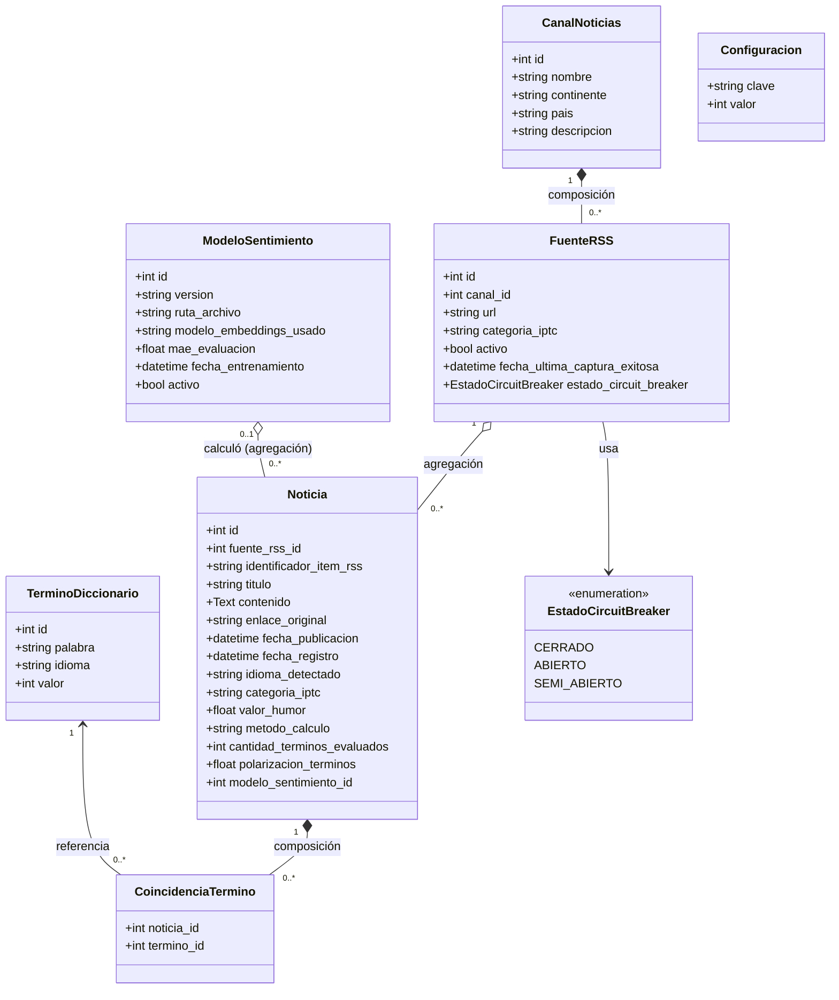

# Modelo de Clases / Entidad-Relación — HumWorld (sistema completo)

**Proyecto:** HumWorld — Equipo 3
**Origen:** PDF de especificaciones, sección 4.7.3.b ("Documentación UML de diseño → Modelo Entidad/Relación o diagrama de clases").
**Alcance:** modelo de datos completo del sistema, cubriendo las cuatro épicas (EPIC-RSS, EPIC-SENT, EPIC-DASH, EPIC-ADMIN). Decisiones de modelado en `ADR-002` (composición CanalNoticias→FuenteRSS), `ADR-003` (algoritmo de sentimiento) y `ADR-004` (modelo de ML).
**Formato elegido:** diagrama de clases UML (el PDF ofrece E/R y clases como equivalentes); permite expresar directamente composición y agregación, que `ADR-002` exige modelar.
**Estado:** refleja el código implementado en `src/app/models/` y las migraciones de `alembic/versions/`.

> **Nota de organización (2026-10-29):** este diagrama consolida en un solo modelo las entidades de todas las épicas. Antes, el modelo estaba repartido entre `diagrama-clases.md` (EPIC-RSS) y `diagrama-clases-sentimiento.md` (EPIC-SENT). La separación por épica no estaba documentada como decisión del equipo en ningún ADR ni steering; se unifica aquí porque el modelo de datos es transversal (p. ej. `Noticia` nace en EPIC-RSS y la extiende EPIC-SENT; `Configuracion` es de EPIC-ADMIN pero la usa el cron de EPIC-RSS).

## Diagrama

## Entidades por épica

- **EPIC-RSS:** `CanalNoticias`, `FuenteRSS` (con el enum `EstadoCircuitBreaker`), `Noticia` (campos base de captura).
- **EPIC-SENT:** extensión de `Noticia` (`valor_humor`, `metodo_calculo`, `cantidad_terminos_evaluados`, `polarizacion_terminos`, `modelo_sentimiento_id`), `TerminoDiccionario`, `CoincidenciaTermino` (tabla `noticia_termino`) y `ModeloSentimiento`.
- **EPIC-ADMIN:** `Configuracion` (parámetros clave-valor: periodicidad del cron y caducidad de noticias).
- **EPIC-DASH:** no introduce entidades propias; consume agregaciones sobre `Noticia`, `CanalNoticias` y `CoincidenciaTermino`.

## Justificación de las relaciones (ver ADR-002, ADR-003, ADR-004)

- **`CanalNoticias` ◆── `FuenteRSS` (Composición):** una `FuenteRSS` no tiene existencia independiente de su `CanalNoticias`. Coherente con la sección 8 del proyecto (usa este par como caso de referencia de composición) y con el código (`app/models/canal.py`, `cascade="all, delete-orphan"`).
- **`FuenteRSS` ── `Noticia` (Agregación):** una `Noticia` capturada tiene valor analítico propio e independiente del ciclo de vida de su fuente. `FuenteRSS.noticias` (`app/models/fuente.py`) **no** declara cascade de borrado, lo que la hace agregación y no composición. La política exacta de borrado de `Noticia` queda como punto abierto pendiente de validación del equipo (ver `ADR-002`, "Negativas y deuda aceptada", y la nota de diseño de HU-RSS-005); que HU-RSS-005 use *soft delete* (`activo=false`) en `FuenteRSS` es una decisión de la capa de servicio y no cierra esa pregunta. Este diagrama documenta el estado actual del código.
- **`Noticia` ◆── `CoincidenciaTermino` (Composición, HU-SENT-008):** una coincidencia no tiene sentido sin su noticia; al eliminarse la noticia (purgado) se eliminan sus coincidencias (`ON DELETE CASCADE`, migración `e5a1c7d3f9b2`).
- **`TerminoDiccionario` ──< `CoincidenciaTermino` (Referencia, HU-SENT-008):** al eliminarse un término, sus coincidencias se borran en cascada. La tabla de unión `noticia_termino` (clave compuesta `noticia_id`+`termino_id`) alimenta la nube de palabras (HU-DASH-003-v2, `GET /api/v1/dashboards/word-cloud`): registra qué términos coincidieron en cada noticia sin reprocesar el texto en cada lectura.
- **`ModeloSentimiento` ──o `Noticia` (Agregación):** una `Noticia` calculada con un modelo referencia su versión (`modelo_sentimiento_id`, nullable, `ON DELETE SET NULL`), pero ambos tienen ciclos de vida independientes: la noticia conserva su `valor_humor` aunque el modelo desaparezca, y un modelo recién entrenado puede existir con cero noticias.
- **`estado_circuit_breaker`** es un atributo de `FuenteRSS`, no una entidad propia; modela el Circuit Breaker por fuente (regla de resiliencia de `docs/architecture.md`, sección 9).

## Notas de los campos de sentimiento en `Noticia`

- **`valor_humor`** (float, nullable): promedio de los valores de los términos únicos coincidentes (ADR-003, HU-SENT-007-v3); NULL si no hubo términos evaluables.
- **`metodo_calculo`** (`"diccionario"` | `"ml"` | NULL): NULL = la noticia aún no fue procesada; es la marca que usa el barrido de respaldo (HU-SENT-002-v3), no `valor_humor` (que también es NULL cuando hubo 0 coincidencias).
- **`cantidad_terminos_evaluados`** (int): términos únicos del diccionario que coincidieron (divisor `n` del promedio).
- **`polarizacion_terminos`** (float, nullable): desviación estándar poblacional de los valores de los términos coincidentes (HU-SENT-003, migración `a7c3e9b5d1f4`); NULL si no hubo términos, 0.0 con un solo término.
- **`modelo_sentimiento_id`** (int, nullable): versión del modelo usada cuando `metodo_calculo="ml"` (HU-SENT-006, migración `d8b2f6a4c7e3`).

## Correspondencia con el código implementado

| Elemento del diagrama | Fichero real en el repositorio |
|---|---|
| `CanalNoticias` | `src/app/models/canal.py` |
| `FuenteRSS`, `EstadoCircuitBreaker` | `src/app/models/fuente.py` |
| `Noticia` | `src/app/models/noticia.py` |
| `TerminoDiccionario` | `src/app/models/termino_diccionario.py` |
| `CoincidenciaTermino` (`noticia_termino`) | `src/app/models/coincidencia_termino.py` |
| `ModeloSentimiento` | `src/app/models/modelo_sentimiento.py` |
| `Configuracion` | `src/app/models/configuracion.py` |

## Historial de revisión

| Versión | Fecha | Motivo del cambio |
|---|---|---|
| v1.0 | 2026-09-02 | Creación como modelo de EPIC-RSS (CanalNoticias, FuenteRSS, Noticia, EstadoCircuitBreaker). |
| v2.0 | 2026-10-29 | Consolidación en el modelo del sistema completo (rol Documentación): se integran las entidades de EPIC-SENT (TerminoDiccionario, CoincidenciaTermino, ModeloSentimiento y la extensión de Noticia) antes en `diagrama-clases-sentimiento.md`, y se agrega `Configuracion` (EPIC-ADMIN). Fiel al código y las migraciones. Reemplaza y absorbe a `diagrama-clases-sentimiento.md`. |
