# Diagrama de Componentes — HumWorld (sistema completo)

**Proyecto:** HumWorld — Equipo 3
**Origen:** PDF de especificaciones, sección 4.7.3.c ("Documentación UML de diseño → Diagrama de componentes"). Arquitectura en capas en `docs/architecture.md` y `ADR-001`/`ADR-002`; motor de sentimiento en `ADR-003`/`ADR-004`; frontend en `ADR-005`.
**Alcance:** componentes del sistema completo (las cuatro épicas), con los nombres de fichero reales del repositorio.
**Estado:** refleja el código implementado en `src/app/` y `frontend/src/`.

> **Nota de organización (2026-10-29):** este diagrama consolida los componentes de todas las épicas en uno solo. Antes solo existía un diagrama de componentes de EPIC-SENT (`diagrama-componentes-sentimiento.md`), con nombres de fichero "propuestos" que no coincidían con el código; EPIC-RSS no tenía diagrama de componentes pese a exigirlo §4.7.3.c. Este diagrama lo reemplaza y usa los ficheros reales.

## Diagrama

```mermaid
flowchart TB
    subgraph FE["Frontend — SPA React (frontend/src/, ADR-005)"]
        FEapp["App.jsx + pantallas/ + componentes/"]
        FEapi["api/cliente.js"]
    end

    subgraph API["Capa API — routers FastAPI (src/app/routers/)"]
        Rchannels["channels.py"]
        Rsources["sources.py"]
        Rcaptures["captures.py"]
        Rconfig["configuracion.py"]
        Rdict["dictionary.py"]
        Rsent["sentiment.py"]
        Rtrain["trainings.py"]
        Rdash["dashboards.py"]
        Rnews["news.py"]
        Rhealth["health.py"]
    end

    subgraph SVC["Capa de Servicios (src/app/services/)"]
        Scanal["canal_service.py"]
        Sfuente["fuente_service.py"]
        Scaptura["captura_service.py"]
        Sconfig["configuracion_service.py"]
        Sdict["dictionary_service.py"]
        Ssent["sentimiento_service.py\n(orquestador humor)"]
        Slema["lematizacion.py"]
        Sconsulta["consulta_sentimiento_service.py"]
        Sml["modelo_ml_service.py"]
        Semb["embeddings_service.py"]
        Sdash["dashboard_service.py"]
        Snoticia["noticia_consulta_service.py"]
        Spurgado["purgado_service.py"]
        Sseed["seed_service.py / seed_diccionario_service.py"]
    end

    subgraph REPO["Capa de Repositorios (src/app/repositories/)"]
        RepoCanales["canales.py"]
        RepoFuentes["fuentes.py"]
        RepoNoticias["noticias.py / noticias_consulta.py"]
        RepoConfig["configuracion.py"]
        RepoDict["dictionary.py"]
        RepoSent["sentimiento.py"]
        RepoDash["dashboards.py"]
        RepoModelos["modelos_sentimiento.py"]
    end

    subgraph SCHED["Scheduler interno (src/app/jobs/scheduler.py, APScheduler)"]
        Jcaptura["Job captura automática (HU-RSS-006)"]
        Jbarrido["Job barrido de humor (HU-SENT-002-v3)"]
        Jpurgado["Job purgado (HU-ADMIN-002)"]
    end

    subgraph PERSIST["Persistencia"]
        MySQL[("MySQL (Alembic)")]
        Disco[["Disco / volumen Docker\n(.joblib, ADR-004)"]]
    end

    subgraph EXT["Servicios externos"]
        RSS[["Feeds RSS externos"]]
        Gemini[["Google Gemini Embedding (ADR-004)"]]
    end

    FEapp --> FEapi
    FEapi -- "HTTP/JSON /api/v1" --> API

    Rchannels --> Scanal
    Rsources --> Sfuente
    Rcaptures --> Scaptura
    Rconfig --> Sconfig
    Rdict --> Sdict
    Rsent --> Sconsulta
    Rsent --> Ssent
    Rtrain --> Sml
    Rdash --> Sdash
    Rnews --> Snoticia
    Rnews --> Spurgado

    Scanal --> RepoCanales
    Sfuente --> RepoFuentes
    Scaptura --> RepoFuentes
    Scaptura --> RepoNoticias
    Scaptura -. "Timeout/Retry/Circuit Breaker" .-> RSS
    Scaptura --> Ssent
    Sconfig --> RepoConfig
    Sdict --> RepoDict
    Sdict --> Ssent
    Ssent --> Slema
    Ssent --> RepoDict
    Ssent --> RepoNoticias
    Ssent -. "Timeout + fallback a diccionario" .-> Sml
    Sml --> Semb
    Sml --> RepoModelos
    Sml --> Disco
    Semb -. "embeddings (Timeout/Retry/Circuit Breaker)" .-> Gemini
    Sconsulta --> RepoSent
    Sdash --> RepoDash
    Snoticia --> RepoNoticias
    Spurgado --> RepoNoticias

    RepoCanales --> MySQL
    RepoFuentes --> MySQL
    RepoNoticias --> MySQL
    RepoConfig --> MySQL
    RepoDict --> MySQL
    RepoSent --> MySQL
    RepoDash --> MySQL
    RepoModelos --> MySQL

    Jcaptura --> Scaptura
    Jbarrido --> Ssent
    Jpurgado --> Spurgado
    Sconfig -. "reprograma" .-> Jcaptura
```

## Reglas de dependencia (separación de capas de `docs/architecture.md`)

- Los routers validan la entrada (Pydantic, según los contratos de `docs/Contratos/`) y delegan a Servicios. No acceden a MySQL ni a servicios externos.
- Los servicios no dependen del framework web; toda sentencia de acceso a datos vive en los repositorios.
- `sentimiento_service.py` es el orquestador del cálculo de humor: aplica Timeout sobre `modelo_ml_service.py` y cae a `lematizacion.py` + diccionario si el modelo falla o se excede el timeout (HU-SENT-002-v3, ADR-004).
- `embeddings_service.py` es el único que llama a Google Gemini Embedding (cálculo e entrenamiento), con Timeout, Retry acotado y Circuit Breaker (ADR-004).
- `captura_service.py` es el único que llama a los feeds RSS externos, con los mismos patrones de resiliencia (ADR-002); tras cada captura dispara el cálculo de humor.
- El scheduler (`jobs/scheduler.py`) registra tres jobs (captura, barrido de humor, purgado) y reprograma el de captura cuando cambia la periodicidad en `/config`.
- El frontend (ADR-005) solo consume `GET`/datos ya agregados vía `api/cliente.js`; no calcula humor ni accede a MySQL.

## Correspondencia con el código

Todos los nombres de fichero de este diagrama existen en el repositorio: routers en `src/app/routers/`, servicios en `src/app/services/`, repositorios en `src/app/repositories/`, scheduler en `src/app/jobs/scheduler.py`, modelos en `src/app/models/`, y el frontend en `frontend/src/`.

## Historial de revisión

| Versión | Fecha | Motivo del cambio |
|---|---|---|
| v1.0 | 2026-10-29 | Creación. Diagrama de componentes del sistema completo (las cuatro épicas + frontend), construido a partir del código real. Cubre el hueco de §4.7.3.c (no existía diagrama de componentes de EPIC-RSS) y reemplaza a `diagrama-componentes-sentimiento.md`, cuyos nombres de fichero eran propuestos y no coincidían con el código. |
